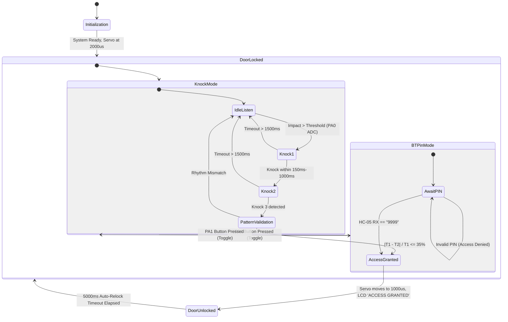
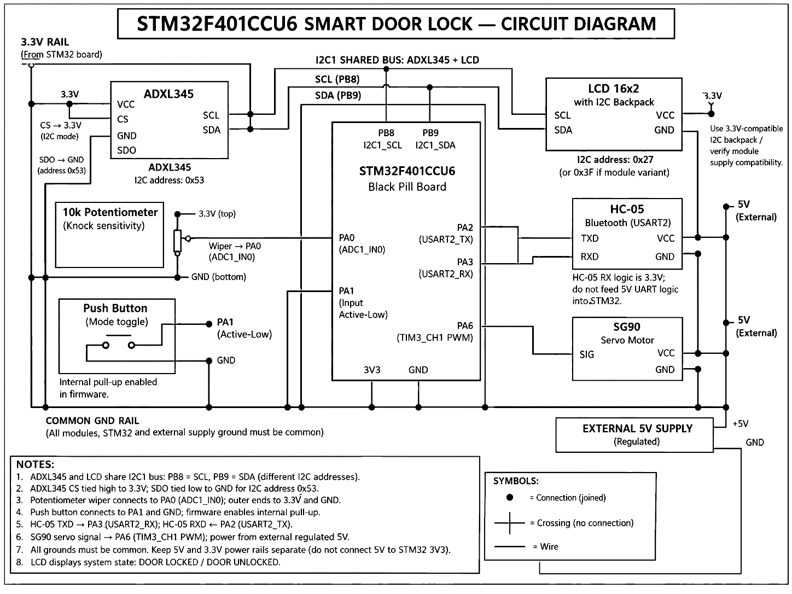
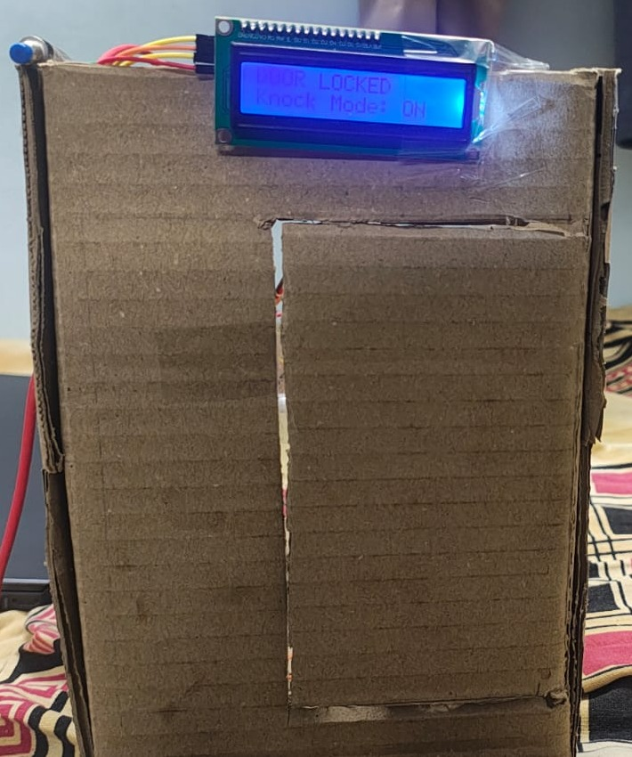
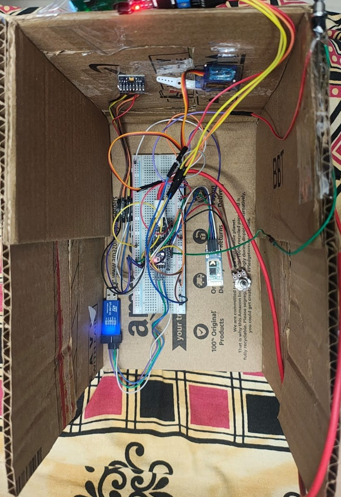

# STM32-Based Knock Pattern Smart Door Lock
### Keyless Access Using Accelerometer-Based Knock Rhythm Analysis

---

## 🎓 Academic Details & Submission Information

| Parameter | Details |
| :--- | :--- |
| **Course** | **23CSE304 – Embedded Systems** |
| **Course Mentor** | **Dr. A. Baskar** |
| **Department** | **Department of Computer Science and Engineering** |
| **Institution** | **School of Computing, Amrita Vishwa Vidyapeetham, Coimbatore, India** |
| **Academic Year** | 2026 – 2027 |
| **Submission Platform** | GitHub Repository & Academic Case Study Submission Form |

### 👥 Student Team Members & Registration Numbers

| Sl. No. | Student Full Name | University Registration Number | Role / Module Contribution |
| :---: | :--- | :--- | :--- |
| 1 | **V. Saketh** | **CB.SC.U4CSE24558** | Firmware architecture, I2C ADXL345 & LCD driver, Web telemetry application |
| 2 | **Y. Jothi Basu** | **CB.SC.U4CSE24559** | Timing analysis, knock interval algorithm & pattern matching logic |
| 3 | **T. Rohit Reddy** | **CB.SC.U4CSE24551** | ADC potentiometer calibration, sensitivity thresholding & debouncing |
| 4 | **T. Kumar** | **CB.SC.U4CSE24552** | TIM3 PWM servo actuator integration & hardware prototype construction |
| 5 | **Vageesh Raj V S** | **CB.SC.U4CSE24554** | HC-05 USART2 Bluetooth duplex telemetry & communication parser |

---

## 📋 Table of Contents
1. [Problem Statement](#1-problem-statement)
2. [Objectives](#2-objectives)
3. [Proposed Solution](#3-proposed-solution)
4. [System Architecture & Working](#4-system-working)
5. [Circuit Design & Schematic](#5-circuit-design--schematic)
6. [Hardware Pin Mapping](#6-pin-mapping)
7. [Physical Prototype](#7-prototype)
8. [Firmware Implementation](#8-firmware-implementation)
9. [Web Application & HC-05 Telemetry Dashboard](#9-web-application--hc-05-telemetry-dashboard)
10. [Testing Plan & Experimental Protocol](#10-testing-plan)
11. [Limitations & Future Work](#11-limitations-and-future-work)
12. [Acknowledgement](#12-acknowledgement)
13. [Repository Directory Structure](#13-repository-directory-structure)
14. [How to Run the Project](#14-how-to-run-the-project)

---

## 1. Problem Statement
Physical keys, numeric PIN keypads, and RFID cards suffer from significant security and practical vulnerabilities:
- Physical keys and duplicate cards can be easily misplaced, lost, stolen, or duplicated without authorization.
- Numeric PIN keypads are susceptible to shoulder-surfing, wear marks revealing frequently pressed digits, and credential sharing.
- Conventional mechanical or standalone digital locks fail to provide real-time telemetry or alert owners after unauthorized entry attempts.

This project delivers a keyless, clandestine, and tactile access control solution: the door unlocks only when the user reproduces a rhythmic knock pattern on the door surface or an integrated wooden panel, supplemented by secure wireless Bluetooth override and live telemetry.

---

## 2. Objectives
- **Core Processing:** Deploy a bare-metal embedded access control system on the **STM32F401CCU6 (ARM Cortex-M4 Black Pill)** running at 16 MHz HSI.
- **Vibration Sensing:** Interface an **ADXL345 3-axis digital accelerometer** over the shared **I²C1** bus (PB8/PB9) to capture acoustic/kinetic knock shockwaves.
- **Pattern Recognition Algorithm:** Measure temporal inter-knock time intervals ($T_1, T_2$) with millisecond SysTick precision and validate rhythm symmetry within an adjustable tolerance limit ($\le 35\%$).
- **Dynamic Sensitivity Calibration:** Sample a 10 kΩ potentiometer through a 12-bit SAR ADC (**ADC1 Channel 0 / PA0**) to adaptively adjust threshold strength across varying door densities and ambient vibration levels.
- **Physical Actuation:** Control an **SG90 micro-servo motor** via 50 Hz PWM generated by hardware **TIM3 Channel 1 (PA6)** to toggle the mechanical deadbolt latch.
- **Visual Feedback:** Interface a **16×2 HD44780 LCD via PCF8574 I²C backpack** to display real-time system state (`DOOR LOCKED`, `ACCESS GRANTED`, `Knock Mode: ON`, `BT PIN Mode`).
- **Wireless Telemetry & Web Dashboard:** Stream duplex status and telemetry via **HC-05 Bluetooth (USART2 / PA2/PA3)** at 9600 baud to an interactive Web Serial dashboard.
- **Manual Mode Override:** Provide a debounced push button on **PA1** to toggle between knock detection mode and Bluetooth PIN mode.

---

## 3. Proposed Solution
The STM32F401CCU6 microcontroller monitors tri-axial acceleration vectors $(x, y, z)$ from the ADXL345 accelerometer sampled at 50 Hz (every 20 ms). When kinetic impact exceeds the dynamic threshold set by the ADC-read potentiometer, the firmware records the knock timestamp.

A valid sequence consists of three consecutive rhythmic knocks. The firmware calculates the duration of interval 1 ($T_1 = t_2 - t_1$) and interval 2 ($T_2 = t_3 - t_2$). If both intervals fall within acceptable human cadence boundaries ($150\,\text{ms} \le T \le 1000\,\text{ms}$) and the relative percentage difference $|T_1 - T_2| \le 0.35 \times T_1$, access is granted. The servo actuator rotates to $1000\,\mu\text{s}$ (~0° unlock position), an auto-relock timer is armed for 5 seconds ($5000\,\text{ms}$), and status updates are transmitted over Bluetooth and displayed on the I²C LCD.

---

## 4. System Working



### Operational Steps:
1. **Power-On Initialization:** Configures SysTick timebase, GPIO modes, I²C1 hardware bus, ADC1 peripheral, USART2 serial engine, and TIM3 PWM channel.
2. **ADXL345 Validation:** Queries Device ID register `0x00` (must match `0xE5`). If matched, configures power control (`0x2D`) and $\pm 2g$ full-resolution measurement mode (`0x31`).
3. **Threshold Calibration:** Reads PA0 (ADC1_IN0) to calculate dynamic threshold:
   $$\text{Threshold} = 20 + \left(\frac{\text{ADC\_Value} \times 180}{4095}\right)$$
4. **Knock Sequence Matching:** Evaluates dynamic vector differences:
   $$\Delta x = |x_k - x_{k-1}|, \quad \Delta y = |y_k - y_{k-1}|, \quad \Delta z = |z_k - z_{k-1}|$$
   $$\text{Strength} = \max(\Delta x, \Delta y, \Delta z)$$
   If $\text{Strength} > \text{Threshold}$ and $\Delta t \ge 180\,\text{ms}$ (software debounce):
   - **Knock 1:** Store timestamp $t_1$, update LCD: `Knock: [*  ]`
   - **Knock 2:** Check $150\,\text{ms} \le (t_2 - t_1) \le 1000\,\text{ms}$, store $t_2$, update LCD: `Knock: [** ]`
   - **Knock 3:** Check $150\,\text{ms} \le (t_3 - t_2) \le 1000\,\text{ms}$, compute interval symmetry:
     $$|T_1 - T_2| \times 100 \le T_1 \times 35$$
5. **Access Grant & Auto-Relock:**
   - Correct pattern rotates SG90 to $1000\,\mu\text{s}$, displays `ACCESS GRANTED`, sends `\r\nDOOR UNLOCKED\r\n` to Bluetooth.
   - After $500\,\text{ms}$, PWM duty cycle is muted to eliminate servo idle heating and power supply sag.
   - After $5000\,\text{ms}$, system automatically relocks ($2000\,\mu\text{s}$) and resets state.

---

## 5. Circuit Design & Schematic

The circuit design utilizes an isolated dual-rail architecture:
- **Microcontroller & Sensors Rail:** Powered at regulated **3.3V** directly from the STM32 board regulator.
- **Actuator Power Rail:** SG90 servo motor requires an **external regulated 5V 2A power supply** to prevent electrical noise and voltage dips on the digital microcontroller rails during motor stall/rotation.
- **Common Ground:** All module grounds, power supplies, and the STM32 board share an equipotential ground plane.


*Figure 1: Complete circuit schematic of the STM32F401CCU6 Smart Door Lock system.*

---

## 6. Pin Mapping

| STM32 Pin | Function / Alternate Function | Hardware Peripheral | Connects To | Electrical Notes |
| :--- | :--- | :--- | :--- | :--- |
| **PB8** | `I2C1_SCL` (AF4) | I²C1 | ADXL345 SCL & 16×2 LCD SCL | Shared bus; requires $4.7\,\text{k}\Omega$ pull-up to 3.3V |
| **PB9** | `I2C1_SDA` (AF4) | I²C1 | ADXL345 SDA & 16×2 LCD SDA | Shared bus; requires $4.7\,\text{k}\Omega$ pull-up to 3.3V |
| **PA0** | `ADC1_IN0` (Analog) | 12-bit SAR ADC1 | 10 kΩ Potentiometer Wiper | Outer pins to 3.3V & GND; dynamic threshold input |
| **PA1** | `GPIO_Input` (Pull-Up) | GPIO Port A | Push Button to GND | Active-low; internal software pull-up enabled |
| **PA2** | `USART2_TX` (AF7) | USART2 (9600 Baud) | HC-05 Bluetooth RXD | 3.3V logic serial transmit |
| **PA3** | `USART2_RX` (AF7) | USART2 (9600 Baud) | HC-05 Bluetooth TXD | 3.3V logic serial receive |
| **PA6** | `TIM3_CH1` (AF2) | TIM3 50 Hz PWM | SG90 Servo Signal (SIG) | 50 Hz PWM ($1000\,\mu\text{s} - 2000\,\mu\text{s}$) |
| **3V3** | Power Output | Voltage Regulator | ADXL345 VCC, LCD VCC (3.3V logic) | Dedicated sensor power |
| **GND** | Ground | Ground Plane | Common Ground Rail | Joined with External 5V Power Supply GND |

> **I²C Address Addressing:**
> - ADXL345: Address `0x53` (tied CS to 3.3V for I²C mode, SDO to GND).
> - 16×2 Character LCD: Address `0x27` (PCF8574T) or `0x3F` (PCF8574AT).

---

## 7. Prototype

The physical prototype is constructed using an enclosed demonstration door assembly featuring real-time visual feedback and modular sensor placement:

| Exterior Door Panel & Status Display | Interior Hardware & Wiring Enclosure |
| :---: | :---: |
|  |  |
| *Figure 2: Exterior door model with 16×2 I²C LCD showing system status.* | *Figure 3: Interior circuitry showing STM32 Black Pill, HC-05, ADXL345, potentiometer, ST-LINK V2, and SG90 servo.* |

---

## 8. Firmware Implementation

The firmware is developed in bare-metal C without heavy HAL overhead, utilizing direct CMSIS register manipulation for maximum execution efficiency and deterministic timing:

- **SysTick Timer (`SysTick_Init`, `SysTick_Handler`):** Configured for a $1\,\text{ms}$ periodic interrupt ($16\,\text{MHz} / 16000$) to provide non-blocking timestamps and debounce counters.
- **Robust I²C1 Driver (`I2C1_Init`, `I2C1_Reset`, `ADXL_ReadBurst`, `LCD_WriteByte`):** Features software timeout counters (`10000` iterations) and automatic bus-reset sequences (`SWRST`) to recover gracefully from line noise or bus stalls.
- **Adaptive ADC Sampling (`ADC1_Init`, `ADC1_Read`):** Configures single-conversion mode with software triggering on Channel 0, sampling 12-bit raw integer data ($0 - 4095$).
- **PWM Actuator Control (`Servo_Init`, `Servo_SetPosition`, `Servo_Process`):** Timer 3 Prescaler = 15, ARR = 19999 generates a precise $20\,\text{ms}$ ($50\,\text{Hz}$) PWM period. Pulse widths are set between $1000\,\mu\text{s}$ (Unlocked) and $2000\,\mu\text{s}$ (Locked), with an automatic sleep timer ($500\,\text{ms}$) that zeros the duty cycle to prevent gear jitter and eliminate idle power draw.
- **Telemetry Streaming (`UART_SendTelemetry`):** Automatically packages live ADC sensitivity data into formatted packets `[POT:<raw>,THR:<thresh>]\r\n` and streams them over USART2 to the web application.

---

## 9. Web Application & HC-05 Telemetry Dashboard

An interactive browser-based telemetry and access control center is included in the [`web_app/`](web_app/) directory:

- **Built with:** HTML5, Tailwind CSS, Chart.js, and the native **Web Serial API**.
- **Connectivity:** Connects directly to the HC-05 Bluetooth module over a virtual Bluetooth COM port at 9600 baud.
- **Key Dashboard Features:**
  - **Live Knock Progress Visualization:** Real-time 3-step knock indicators tracking timing windows.
  - **Dynamic Sensitivity Gauge:** Live graphical gauge reflecting PA0 potentiometer position and calculated vibration threshold.
  - **Real-Time Telemetry Plot:** Real-time Chart.js time-series streaming vibration and threshold variations.
  - **Remote Keypad & Command Console:** Interactive digital keypad allowing remote transmission of PIN (`9999`) or custom AT/serial commands.
  - **Two-Way Serial Log Terminal:** Timestamps every transmission and reception event with color-coded packet inspection.

```bash
# To launch the Web Dashboard:
cd web_app
python server.py
# Or simply double-click run_app.bat in the root folder
```

---

## 10. Testing Plan

The experimental verification protocol was designed to evaluate accuracy, timing tolerances, and actuator reliability:

| Test Case | Description & Methodology | Acceptance Criteria |
| :--- | :--- | :--- |
| **Correct Knock Pattern Repeatability** | Perform 20 trials knocking the secret cadence within $150\,\text{ms} - 1000\,\text{ms}$. | 100% unlock success rate; servo completes full angular travel. |
| **Near-Miss & Random Knock Rejection** | Perform 20 trials with irregular rhythms, single knocks, or random taps. | 0% false acceptance; system remains in locked state. |
| **Sensitivity Sweep** | Adjust 10 kΩ potentiometer to low, medium, and high positions and test against soft and hard impacts. | Threshold scales proportionally from 20 to 200 vibration units. |
| **Timing Tolerance Verification** | Introduce intentional temporal deviations of $\pm 50\,\text{ms}$ and $\pm 100\,\text{ms}$ between intervals. | Patterns within $35\%$ tolerance accept; outliers rejected. |
| **Bluetooth Range & Latency** | Transmit PIN codes and receive telemetry packets at distances of $1\,\text{m}$, $5\,\text{m}$, and $10\,\text{m}$. | Uninterrupted duplex communication without packet corruption. |
| **Actuator Duty-Cycle Endurance** | Perform 20 continuous unlock/relock cycles under external 5V supply. | Zero voltage sag observed on STM32 3.3V rail; servo latch operates cleanly. |

---

## 11. Limitations and Future Work

### Current Limitations:
- **Acoustic Overhearing:** An observer standing adjacent to the entrance may hear and attempt to mimic the rhythmic cadence.
- **Firmware-Defined Pattern:** In the current iteration, cadence parameters and master PIN are hardcoded into microcontroller flash.
- **Unencrypted Communication:** Standard HC-05 modules utilize legacy Bluetooth SPP without end-to-end payload encryption.
- **Prototype Enclosure:** The physical housing is made of demonstration cardboard and uses a hobby-grade servo intended for academic presentation.

### Future Work:
- **Dynamic Flash/EEPROM Rhythm Recording:** Add a programming mode allowing users to record and store custom rhythm cadences in non-volatile flash memory.
- **Security Lockout & Tamper Alarm:** Implement an exponential backoff lockout penalty after 3 consecutive failed rhythm attempts accompanied by a piezo buzzer alarm.
- **Encrypted BLE 5.0 Module:** Migrate from HC-05 to an encrypted Bluetooth Low Energy (BLE) module (e.g., nRF52840 or ESP32 coprocessor) with AES-128 challenge-response authentication.
- **Interrupt-Driven Wakeup:** Configure ADXL345 `INT1`/`INT2` motion detection interrupts to wake the STM32 Cortex-M4 from `STOP` low-power mode, achieving microampere idle consumption.

---

## 12. Acknowledgement

We express our sincere gratitude and appreciation to our mentor, **Dr. A. Baskar**, for his valuable academic guidance, constructive feedback, and continuous support throughout the development of this case study.

This work was conducted as part of the course **23CSE304 – Embedded Systems** at the **Department of Computer Science and Engineering, School of Computing, Amrita Vishwa Vidyapeetham, Coimbatore, India**.

---

## 13. Repository Directory Structure

```text
embedded-systems/
├── README.md                      # Comprehensive Academic Case Study Report
├── main.c                         # Top-level STM32F401CCU6 firmware source code
├── run_app.bat                    # One-click launcher for the Web Telemetry Dashboard
├── server.py                      # Python HTTP server for Web Serial interface
├── index.html                     # Interactive HC-05 Bluetooth Telemetry Dashboard
├── src/
│   └── main.c                     # Modular firmware source code (CMSIS bare-metal)
├── web_app/
│   ├── index.html                 # Web Serial Bluetooth Control Center application
│   ├── server.py                  # Local instrumentation server
│   └── run_app.bat                # Web App launch script
└── docs/
    ├── STM32_Knock_Pattern_Case_Study_Report.docx         # Formal academic report document
    ├── STM32_Knock_Pattern_Smart_Door_Lock_Presentation.pptx # Project presentation slides
    └── images/
        ├── circuit_diagram.png    # High-resolution hardware circuit schematic
        ├── prototype_exterior.jpg # Exterior prototype enclosure & LCD display
        └── prototype_interior.jpg # Interior electronics, wiring & sensor layout
```

---

## 14. How to Run the Project

### Hardware Setup
1. Wire all components according to the [Hardware Pin Mapping](#6-pin-mapping) and [Circuit Schematic](#5-circuit-design--schematic).
2. Connect the **ST-LINK V2** programmer to the STM32 Black Pill (`SWDIO`, `SWCLK`, `3.3V`, `GND`).
3. Connect an external **5V 2A regulated power supply** to the SG90 servo motor (ensure grounds are common).

### Compiling and Flashing
1. **Using Keil MDK / STM32CubeIDE / Makefile:**
   - Create a project targeting the **STM32F401CCU6**.
   - Include CMSIS device headers (`stm32f4xx.h`, `system_stm32f4xx.c`).
   - Add `src/main.c` to your project and build with `-O2` optimization.
   - Flash the `.hex` or `.bin` firmware via ST-LINK Utility or OpenOCD:
     ```bash
     openocd -f interface/stlink.cfg -f target/stm32f4x.cfg -c "program build/main.elf verify reset exit"
     ```

### Running the Web Telemetry Console
1. Pair your computer's Bluetooth with the **HC-05** module (Default PIN: `1234`).
2. Run `run_app.bat` or execute:
   ```bash
   python server.py
   ```
3. Open `http://127.0.0.1:8085` in Google Chrome or Microsoft Edge (requires Web Serial API support).
4. Click **"Connect HC-05"** and select the paired Bluetooth Serial COM port at **9600 Baud**.
